# Bhojpurify — ET 617 Project Report

**"बोलो अपने अंदाज़ में, लिखो किताब के अंदाज़ में।"** *Speak your own way, write the book's way.*

---

## Identity card

| Field | Value |
|---|---|
| **ID (roll number)** | **23B2509** |
| **P — Problem** | **P2** Contextual language and literacy application (NLP · Language learning · Localisation) |
| **T — Topic** | **T10** Hindi for Bhojpuri-speaking learners: श / स and ड़ |
| **L — Learner context** | **L8** Learner whose home language differs from the school medium (Bhojpuri at home, Hindi at school) |
| **C — Design constraint** | **C4** 10-minute sessions: one complete sequence fits in 10 minutes; the learner can stop and resume |
| **App** | Bhojpurify (guide character: मिट्ठू / Mitthu the parrot) |
| **Live URL** | https://et617-23b2509.vercel.app |
| **Repository** | https://github.com/SamRTAv/et617-endsem-23B2509 |
| **Design document** | `DESIGN.md` in the repository (full detail for every section below) |
| **Licence** | CC BY 4.0 |

---

## D1. Educational problem

**Problem.** Children in Bhojpuri-speaking districts of Bihar and eastern UP learn in Hindi-medium schools but speak Bhojpuri at home. Bhojpuri speech commonly does not separate **श** from **स** (शाम is said "साम") and often says **ड़** like **र** or **ड** (सड़क → "सरक"/"सडक"). Children spell the way they speak, so they write *साम, सहर, सरक, पेर* in dictation and are marked wrong without explanation; many conclude that their home language is "wrong". They need short, private practice that **accepts their accent in speech** while **teaching standard spelling in writing**.

**Learning outcomes (Revised Bloom's verbs)**

| # | Outcome | Level | Success measure |
|---|---|---|---|
| LO1 | **Distinguish** the correct written form when श/स or ड़/ड/र alternatives are given | Analyse | ≥ 8/10 recognition items |
| LO2 | **Spell** common words with श and ड़, including unseen words | Apply | ≥ 8/10 dictated words, incl. ≥ 3 of 4 unseen |
| LO3 | **Explain** why a word is written with श/ड़ even if said differently at home, and **predict** ड vs ड़ with the position rule | Understand / Apply | Rubric score 2 (of 2) |

**Context of use.** At home, ~8:00–8:30 pm, on the father's budget Android phone (~360 px, Chrome, shared prepaid data, patchy 4G); one ~10-minute sitting, often interrupted.

---

## D2. Learner persona — रवि कुमार (Ravi Kumar)

| Field | Detail |
|---|---|
| **Age / class** | 11, Class 6, government Hindi-medium school, Ara (Bhojpur district), Bihar |
| **Language** | Bhojpuri at home; Hindi at school and on TV |
| **Support system** | Parents and elder sister (Class 10, busy with boards). Father works at a hardware shop; mother reads Hindi slowly. No tuition. |
| **Device & time** | Father's Android phone after dinner, ~10 min, 4–5 days a week, often interrupted |
| **Prior knowledge** | Knows the varnamala and matras; reads 3–4 word sentences slowly; recognises श and स on a chart but swaps them in writing; has seen ड़ but doesn't know what the dot means |
| **Misconception M1** | "श और स एक ही आवाज़ हैं, कोई भी लिख दो" → writes **साम, सहर, देस** |
| **Misconception M2** | "ड़ बस ड या र है, बिंदी से फ़र्क नहीं पड़ता" → writes **सडक / सरक, पेर, लरका** |
| **Side risk** | Over-correction once he learns श (**शब** for सब) — tracked by the app |
| **Goal** | Full marks in the Friday dictation |
| **Frustration** | "Ma'am says I speak wrong" — embarrassment about home language |
| **Motivation** | Praise, visible progress, small wins; gives up if corrected harshly or if tasks are long |
| **Theory link** | Language transfer / contrastive analysis (errors come from Bhojpuri phonology); Affective Filter (shame blocks learning); Cognitive Load Theory (slow reader → one short task per screen) |

---

## D3. Educational content

**Structure.** Diagnostic (3 Q) → choose sounds → for each sound block: concept → 4–7 tasks → mid-check after block 1 → summary. One contrast per block: **श/स**, **ड़** (vs ड or र, depending on the cards chosen), **ढ़** (bonus).

**Concept explanation (श-block, as shown by Mitthu)**
> घर पर हम **"साम"** बोलते हैं — यह हमारी भोजपुरी का तरीका है, और यह बिल्कुल ठीक है। पर किताब वाली हिंदी में यह शब्द **श** से लिखा जाता है: **श**ाम।
> **पहली बात:** बोलना और लिखना अलग हो सकते हैं। **दूसरी बात:** कुछ शब्दों में श आता है — शाम, शहर, देश, शेर। **तीसरी बात:** कुछ शब्दों में स ही रहता है — सब, सात, समय। हर स को श मत बनाना! 🧠 *"शाम को शेर शहर आया।"*

**ड़-block concept:** ड़ has a dot below; it **never starts a word** (डर, डाल, डिब्बा); in the middle or end it is usually ड़ (सड़क, पेड़, लड़का); after ं it stays ड (अंडा, ठंडा); saying "पेर/सरक" at home is fine, but we write पेड़, सड़क.

**Task formats (6):** MCQ (choose the word), FILL (missing letter), SPEAK (read aloud, speech recognition), SPELL (build from akshara tiles with confusable distractors), FIND (tap the misspelled word in a sentence), WHY (choose the correct reason).

**Tasks with model answers (श-block; the ड़ and ढ़ blocks follow the same pattern — 21 core tasks in total)**

| # | Format | Prompt | Model answer |
|---|---|---|---|
| S1 | MCQ | 🌆 सूरज डूबने का समय? शाम / साम | **शाम** |
| S2 | FILL | 🏙️ _हर (श / स / ष) | **श** |
| S3 | SPEAK | 🎤 बोलो: शाम | accept **शाम** or **साम** |
| S4 | MCQ | ___ लोग आ गए — सब / शब | **सब** (over-correction check) |
| S5 | SPELL | 🦁 जंगल का राजा — tiles [शे][से][र] | **शेर** |
| S6 | FIND | "शाम को हम **सहर** गए।" | **सहर** → शहर |
| S7 | WHY | "साम" बोलते हैं, "शाम" क्यों लिखते हैं? | "किताब की हिंदी में सही वर्तनी श से है — बोलना अलग हो सकता है" |

ड़-block examples: सड़क/सडक/सरक (MCQ), पे_ → ड़ (FILL), डर/ड़र (position rule), लड़का (SPELL), "मेरा **घोरा** तेज़ दौड़ता है" (FIND), "पेड़ में ड़, डर में ड क्यों?" (WHY). Harder words: आकाश, रोशनी, पहाड़, पकड़ना, ठंडा (nasal exception).

**Feedback (actual text)**

| Response | Feedback shown |
|---|---|
| Correct | शाबाश, रवि! 🎉 **श**ाम में **श** ही आता है। |
| **M1** (स for श) | तुम्हारा बोलना बिल्कुल ठीक है! 😊 पर लिखते समय यहाँ **श** लगता है: **श**हर। चलो, एक बार और। |
| **M2** (ड for ड़) | लगभग सही! 👀 यहाँ ड के नीचे **बिंदी** चाहिए: स**ड़**क। |
| **M2** (र for ड़) | घर पर हम "सरक" बोलते हैं — कोई बात नहीं! पर लिखते हैं स**ड़**क, र नहीं। |
| Over-correction | ध्यान दो! **स**ब में **स** ही आता है। हर स, श नहीं बनता। |
| Spoken dialect variant | बहुत बढ़िया! 🎉 "साम" — यह तुम्हारे इलाके का उच्चारण है, **बिल्कुल ठीक है**। बस लिखते समय याद रखना: **श**ाम। |
| WHY "घर की भाषा ग़लत है" | नहीं! तुम्हारी भोजपुरी ग़लत नहीं है। ❤️ बस **लिखने** का एक तय तरीका है। |

A wrong answer gets one retry; a second wrong answer shows the word and re-queues it two tasks later.

---

## D4. Working application

**URL:** https://et617-23b2509.vercel.app · static HTML/CSS/JS, no backend, < 100 KB, works offline after loading (except speech recognition). The ID badge **ET617 · 23B2509** and the **⏱ countdown** are in the header of every screen.

**Screen map**

```
S1 Welcome ──► S2 Diagnostic ──► S3 Choose sounds ──► S4 Concept ──► S5 Practice ◄──► S6 Feedback
   ▲  (resume card)                                       ▲   ▲           │
   │                                    remediation ──────┘   └── next block
   │                                                                      ▼
S9 Profile ◄── S8 Summary ◄──────────────── S7 Mid-check ◄────────────────┘
   └──► S10 Log (teacher)
```

| Screen | Learner input | System output | Transition |
|---|---|---|---|
| S1 Welcome | Name, class; Start / Continue | Greeting, 10-min plan, resume card ("पिछली बार तुम सवाल 4 पर थे…") | S2 / resume / S9 |
| S2 Diagnostic | 3 MCQ taps | Records weak sounds (no right/wrong shown) | S3 |
| S3 Choose sounds | Toggle cards, 🔊 preview | ⭐ suggested cards from diagnostic, warning on removing one, time estimate | S4 |
| S4 Concept | Tap word chips | Mitthu's explanation, highlighted letters, akshara breakdown | S5 |
| S5 Practice | Tap / tiles / voice / hint | One task in one of 6 formats, level, progress, confidence meter | S6 |
| S6 Feedback | Retry / Next | Error-type-specific feedback | S5 / S4 (remediation) / S7 |
| S7 Mid-check | 2 items, no hints | Pass → next block; fail → 2 extra items | S4 / S5 / S8 |
| S8 Summary | Profile / Done | Score, time, mastery per sound, review words, streak | S9 / S1 |
| S9 Profile | Start / Log / Reset | Streak + 7-day dots, mastery bars, confidence, totals | S1 / S5 / S10 |
| S10 Log | Export / Clear | Clickstream table, JSON export | S9 |

**C4 implementation:** visible countdown (pauses when the tab is hidden); tasks per block scale with the number of blocks chosen (1 → 7, 2 → 5, 3 → 4) so a sequence fits in 10 min; at 9:30 the app finishes the current task and shows the summary; state is saved after every answer and resumed from the exact question; words missed or unfinished are reviewed at the start of the next session.

---

## D5. Two contrasting learner scenarios

Both paths were run on the app at a phone viewport (390 × 844); screenshots are in `screenshots/`. The same paths are re-run automatically by `tests/smoke.test.js`.

### (a) Learner who responds correctly — "Aman"

| Step | System response |
|---|---|
| Diagnostic 3/3 → no ⭐; chooses श/स himself | Block starts at **Level 2** |
| S1–S3 correct first time | "शाबाश, Aman! 🎉"; after 3 in a row → **Level 3**, harder words (देश, आकाश) inserted |
| Mid-check 2/2 | Passed |
| Summary | **9/9**, श/स mastery **100% "सीख लिया ✓"**, streak 🔥1 |

<p>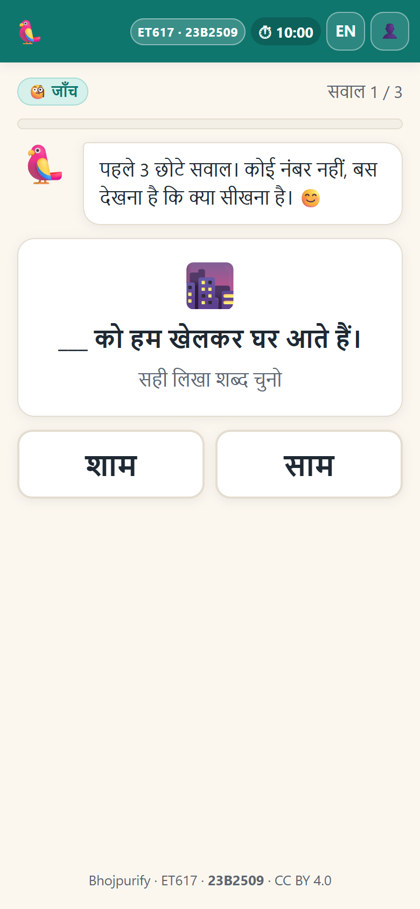 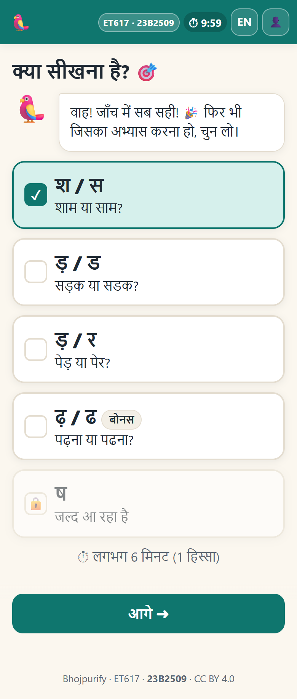 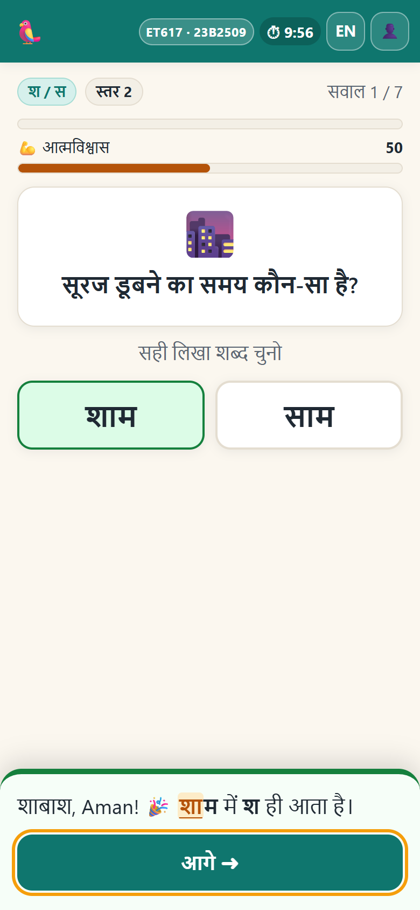 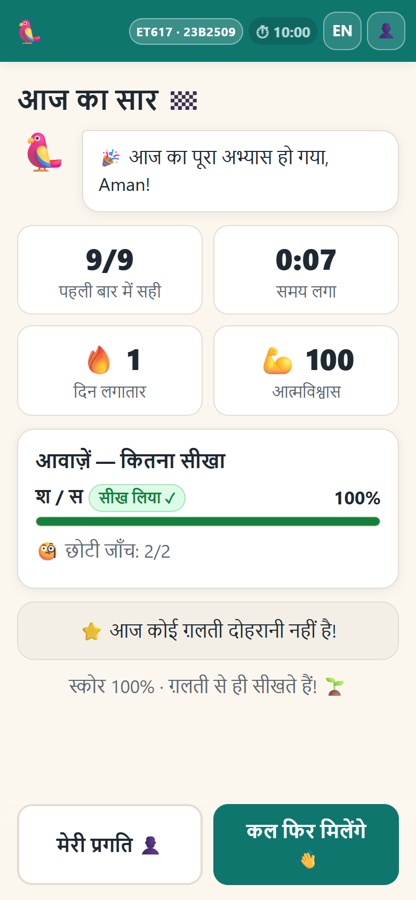</p>

### (b) Learner showing misconception M1 — "Ravi"

| Step | System response (different from A) |
|---|---|
| Diagnostic: picks **साम** | श/स **pre-selected with ⭐ सुझाया गया**; removing it shows a warning; starts at **Level 1** |
| FILL _हर → **स** | Classified **M1**: "तुम्हारा बोलना बिल्कुल ठीक है! पर लिखते समय यहाँ श लगता है…" → retry |
| SPEAK शाम → says **"साम"** | **Accepted as a dialect variant** (variation example) |
| SPELL शेर → builds **सेर** | Second M1 error → **remediation mini-lesson** + 2 easy items, level held at 1 (error example) |
| WHY → "श और स एक ही हैं" | M1 conceptual feedback, correct reason shown |
| Summary | **6/9**, mastery **60%** (not "learned"), review list शहर, शेर, शाम saved for the next session |

<p>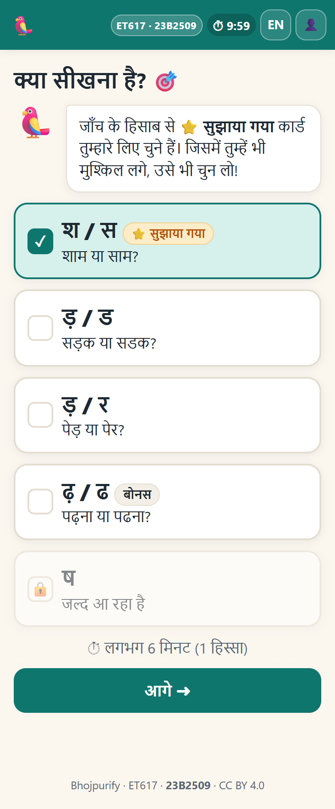 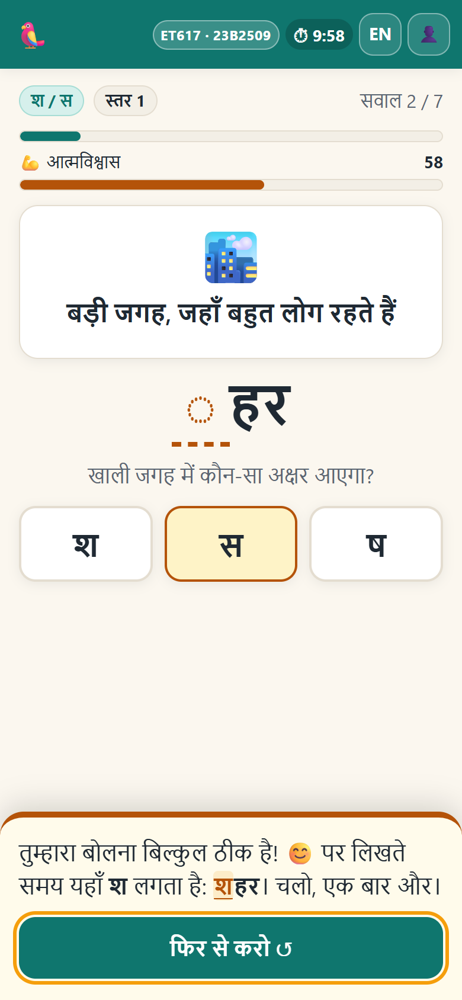 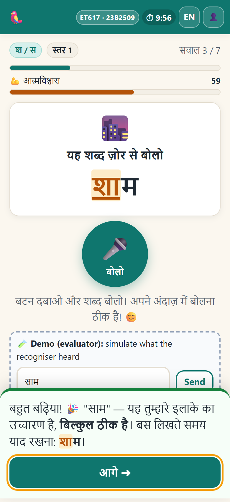 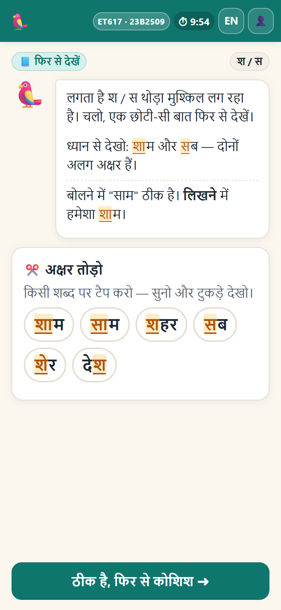</p>
<p>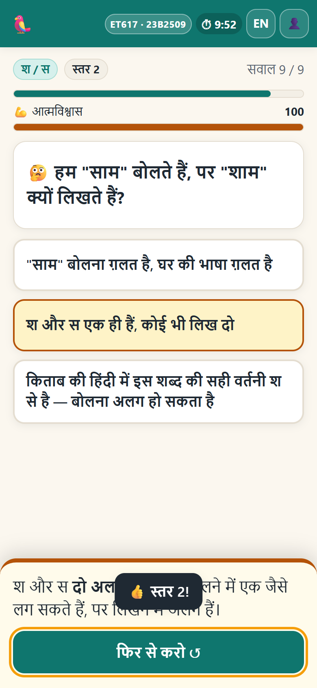 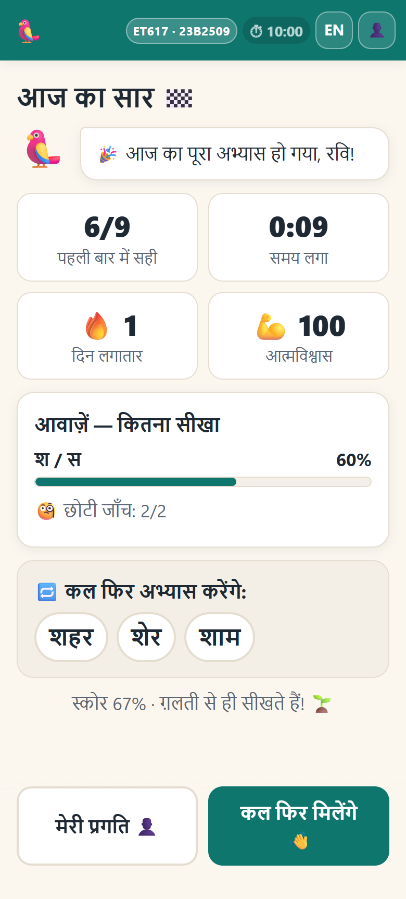 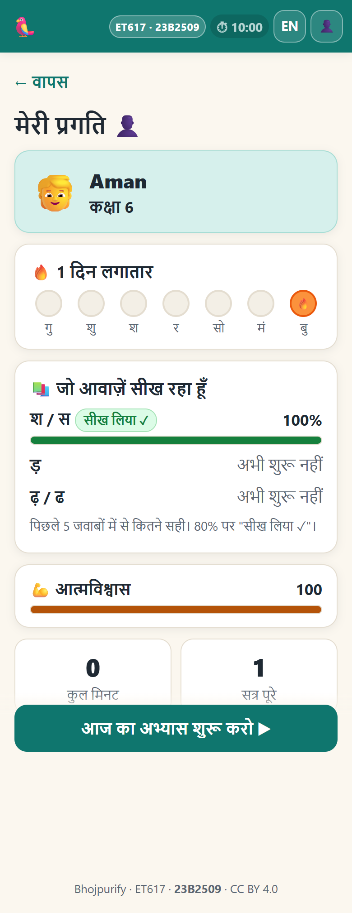 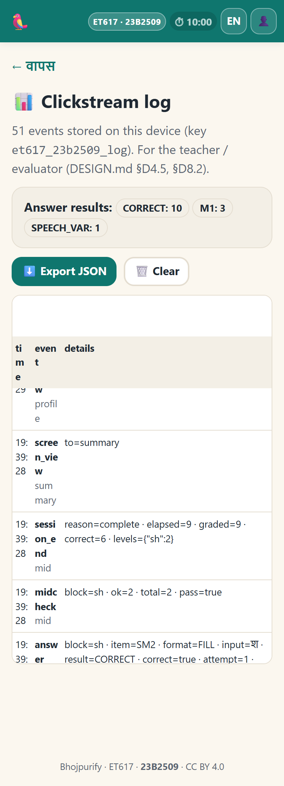</p>

---

## D6. AI functionality specification

### D6.1 Speech recognition (SPEAK task)

| | |
|---|---|
| **What it does** | Turns the spoken word into Hindi text so the app can confirm the word was read. It is **never** used to mark pronunciation wrong. |
| **Model / call** | Browser Web Speech API (Chrome → Google cloud ASR): `rec.lang='hi-IN'; rec.interimResults=false; rec.maxAlternatives=5; rec.start();` |
| **Input** | Microphone audio of one word |
| **Output** | Up to 5 alternatives with confidence, e.g. `[{text:"साम",conf:0.81},{text:"शाम",conf:0.62}]` |
| **Check before the learner sees it** | Unicode NFC normalisation (ड़ U+095C ≡ ड + nukta) → match standard word → else match accepted variant list (शाम: साम; शहर: सहर; सड़क: सरक, सडक; पेड़: पेर; पढ़ना: पढना, परहना …) → else edit distance 1 = "almost, say again" → else "आवाज़ साफ़ नहीं आई". The learner is never told "wrong" for speech. |
| **Fallback** | No browser support, mic denied or network error → the task switches to writing with tiles ("माइक नहीं चला — कोई बात नहीं, लिखकर करते हैं"); two unclear attempts → "लिखकर करो" or "छोड़ो" (skip, not counted). `?demo=1` lets an evaluator type the transcript. |

### D6.2 Spelling-error classifier (FILL, SPELL, FIND)

| | |
|---|---|
| **What it does** | Labels *what kind* of error an answer is, so feedback targets the misconception |
| **Input → output** | `classify("शाम","साम")` → `M1`; labels: CORRECT, M1 (स for श), OVER (श for स), M2_D (ड for ड़), M2_R (र for ड़), M2_DH, POS (ड़ at word start), OVER_D, OTHER |
| **Method** | NFC → ड़/ढ़ tokenised as single units → position-wise comparison against a substitution table |
| **Check** | Deterministic; `tests/nlp.test.js` runs 30 checks on the word bank's common misspellings (all pass) |
| **Fallback** | `OTHER` → neutral feedback showing the correct word with the letter highlighted; logged for teacher review |

### D6.3 Text-to-speech (🔊)
`speechSynthesis` with a `hi-IN` voice. If the device has no Hindi voice the 🔊 buttons are hidden and the emoji + text clue remains.

**Why no LLM:** no per-answer network calls (low data), every message a child sees is pre-written and checked (safety), zero cost. A future version could add LLM-generated practice sentences behind a validator (target word spelled correctly, Class 3–6 vocabulary).

---

## D7. Pedagogical rationale

**Design challenge (P2): error vs. acceptable variation.** The app separates the **channel** from the **standard**:
- **Speech:** accepted if it matches the standard word *or* a known Bhojpuri-influenced pronunciation → **variation example:** Ravi *says* "साम" → "यह तुम्हारे इलाके का उच्चारण है, बिल्कुल ठीक है।"
- **Writing:** only the standard spelling is accepted; Bhojpuri-pattern substitutions get M1/M2 feedback → **error example:** Ravi *writes* "सेर" → M1 feedback, retry, remediation after a second M1 error.

**Design principles ("We will … because …")**
1. We will **accept Bhojpuri pronunciation in speaking tasks** because marking the home language wrong raises anxiety (Affective Filter) and L8 learners need it respected.
2. We will **teach one contrast per block** because working memory holds ~7 ± 2 items and Ravi reads slowly (Cognitive Load Theory).
3. We will **colour the target letter in every word** because attention is the gate from sensory to working memory (Atkinson–Shiffrin).
4. We will **link words to familiar meaning and a memory sentence** because encoding is stronger when connected to prior knowledge.
5. We will **order tasks recognise → recall → produce → analyse → explain** to withdraw support gradually (ZPD/scaffolding, Bloom).
6. We will **give misconception-specific feedback with one retry** because a bare "wrong" doesn't tell him what to change.
7. We will **save after every answer and show a countdown** because the phone may be taken back at any time (C4 + persona).
8. We will **show a confidence meter and streak**, not only a score, because Ravi is motivated by visible progress.
9. We will **keep the app < 100 KB with no media** because the family shares a small data pack.
10. We will **let the learner choose sounds as well as take a diagnostic** to give him control and to learn how accurate self-assessment is.

**Feedback and scaffolding:** immediate error-specific feedback; two-level hints (focus cue, then remove a wrong option), with the hint button pulsing after 20 s idle; retry once, then show and re-queue; remediation mini-lesson; mid-check after block 1.

**Adaptivity (profile + performance + interaction)**
- *Profile:* diagnostic + self-selection decide blocks and starting level (correct in diagnostic → Level 2).
- *Performance:* 3 correct first attempts in a row → level up (Level 3 injects harder words); 2 errors of the same misconception in a block → remediation, level −1; mid-check < 2/2 → 2 extra items.
- *Interaction:* ≥ 2 hints in the last 3 items → hold level and insert a FILL scaffold before the next SPELL; speech failing → switch to writing; idle 20 s → hint pulse.

**How C4 and L8 shaped the design.** C4 → a short fixed sequence, a visible timer, fewer tasks per block when more blocks are chosen, save-and-resume, and a mid-check instead of a long final test. L8 → the speech/writing split, feedback that starts "तुम्हारा बोलना बिल्कुल ठीक है", a WHY item that challenges "my home language is wrong", the Bhojpuri variant table, and a Hindi interface (English toggle for teachers).

**Build process.** Lean/Kanban: a thin working slice first, then features from one prioritised list. Each slice was committed (9+ commits between 19:10 and 19:41, see the GitHub history), tested with `npm test`, and checked as phone screenshots. This caught a header overflow at 390 px, matras detaching from highlighted letters, and remediation items inflating mastery, all fixed before deployment.

---

## D8. Evaluation plan

| Outcome | Assessment | Scoring |
|---|---|---|
| LO1 | 10 MCQ items (5 श/स incl. सब/शब, सात/शात; 5 ड़ incl. डर/ड़र, ठंडा/ठंड़ा) | 1 mark each |
| LO2 | 10-word dictation: 6 practised + **4 unseen** (शरबत, दशहरा, कपड़ा, गाड़ी) + 3 स control words (सपना, सोना, बस) for over-correction | 1 mark each; over-correction counted separately |
| LO3 | Oral "तुम 'साम' बोलते हो, फिर 'शाम' क्यों लिखते हो?" + predict ड/ड़ in _ाकिया, बा_, ठं_ | Rubric 0 (no reason / home language wrong) · 1 (book spelling differs) · 2 (+ states or applies the position rule) |

**Log data (clickstream, exported as JSON):** per answer: response, error label, attempt, latency, hints, level; per sound: mastery trajectory and M1/M2/OVER counts per session; diagnostic vs. self-selected sounds; remediation triggers and the next result; speech attempts, variants accepted, fallback reasons; session time, completion, resumes, streak.

**Success criteria:** LO1 ≥ 8/10 for ≥ 70% of learners; LO2 ≥ 8/10 incl. ≥ 3/4 unseen; LO3 score 2 for ≥ 60%; M1+M2 errors fall ≥ 50% from session 1 to 4; ≤ 1 control word over-corrected; ≥ 80% of sessions completed within 10 min; confidence meter rises and a 3-item smiley survey does not fall.

**Study design:** pilot with 8–10 Class 6 Bhojpuri-speaking learners: pre-test → 4 sessions in one week → post-test → short interviews with 3 learners and their Hindi teacher. Findings feed the next design cycle (Design-Based Research).

---

## AI-use log and reflection

### Log (in order of use)

| # | Tool | Chat link / export | What I used it for |
|---|---|---|---|
| 1 | Claude Code (Claude Opus 5.5), VS Code extension | *[paste exported chat link here]* | One continuous session, in this order: (1) compared P2 vs P4 for a 2-hour build and chose P2; (2) compared topics and chose T10 + L8 + C4; (3) expanded the persona and planned content; (4) reviewed the course rubric and the class slides (Bloom, memory model, CLT, ADDIE, DBR, persona template, dev models) and turned them into design constraints; (5) added my ideas of a self-selection "choose sounds" screen and a profile/streak page; (6) drafted DESIGN.md; (7) wrote the app, NLP layer and tests, committing to GitHub in stages; (8) captured phone screenshots and fixed the layout bugs they revealed; (9) drafted this report. |

### Reflection

**What the AI did well.** It turned the assignment's long list of requirements into a traceable plan (each requirement mapped to a section and a screen) and kept the scope realistic for the time available: it recommended P2 over P4 because P4 would have needed an LLM to evaluate explanations. It applied the class theories concretely (one contrast per block for CLT, Bloom-ordered tasks, the "We will … because …" principle format). It also wrote automated tests that run both D5 scenarios end-to-end, which caught a real bug: missed words were listed in the summary but not saved for the next session.

**What I decided or changed.** I chose the problem and card combination, named the app *Bhojpurify*, and asked for two features the first plan did not have: a screen where the learner can choose sounds beyond the diagnostic's suggestions, and a profile page with a streak and topics. I asked for the class slides to be used as design constraints and asked to review the app on localhost before deployment.

**What I checked rather than trusted.** I reviewed every screen on a phone-width browser before deploying. The screenshot review found problems the code alone didn't show: the header overflowed at 390 px, Devanagari matras detached from highlighted letters (a dotted circle in "श◌ाम"), and easy remediation items made a struggling learner look "learned" (80%). All were fixed before deployment. The classifier is checked by 30 deterministic tests rather than by reading the code.

**Limitations and risks I'm aware of.** The Bhojpuri variant table and the claims about Bhojpuri pronunciation come from general linguistic knowledge and the AI, not from recordings of real learners; they need checking with native speakers and teachers in the pilot. Real speech recognition may "correct" साम to शाम, which is harmless here (both are accepted) but means the variation path is easiest to demonstrate with `?demo=1`. The app has not yet been tested with children; D8 describes how it would be.

**What I learned about using AI for design.** AI is fastest at the parts with clear rules (code, tests, mapping requirements to sections) and needs the most checking where the content depends on real learners and real languages. The most useful habit was asking it to show evidence (test runs, screenshots) instead of accepting "done".
